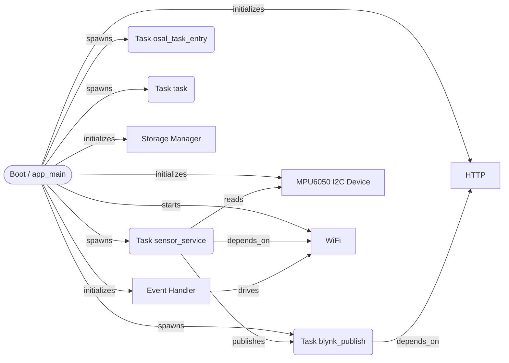
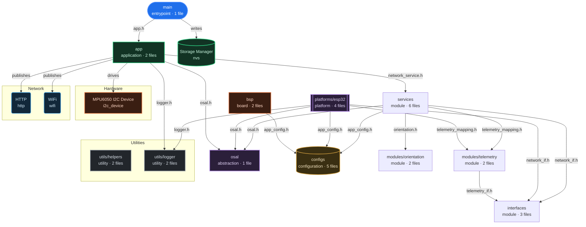
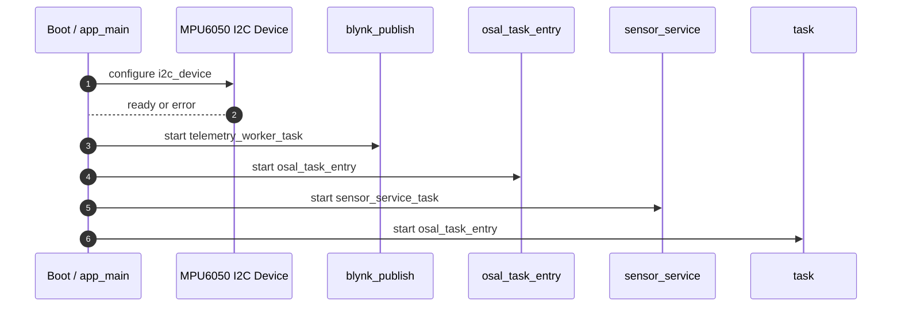
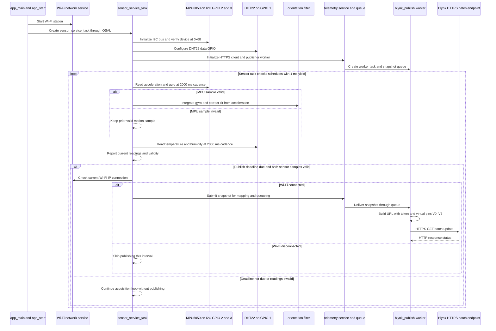
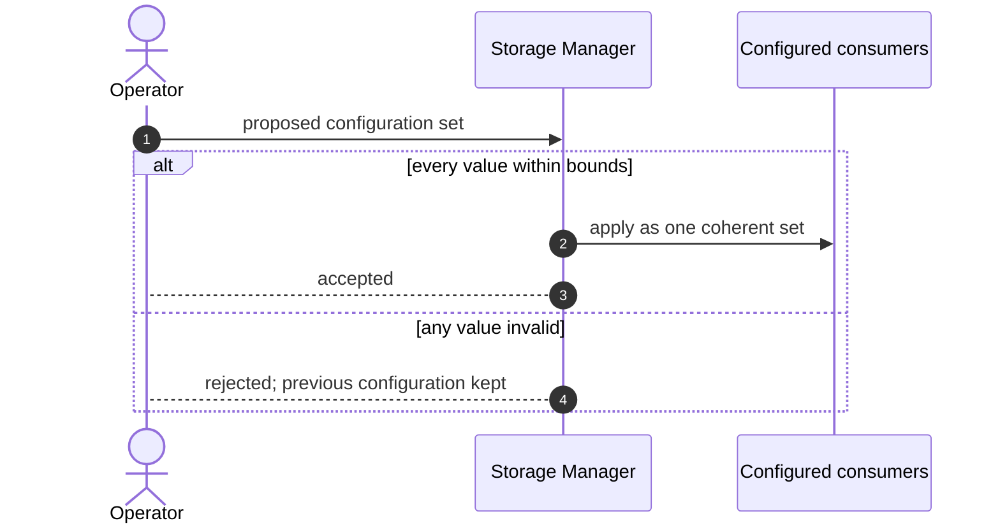

# Firmware Design Specification — espblynk

| Field | Value |
| --- | --- |
| Document ID | FDS-ESPBLYNK-001 |
| Project | espblynk |
| PIR revision | b15ede954b5a3e475338ba1d73b2382a |
| Board | ESP32-C3-DevKitM-1 |
| Target | esp32c3 |
| Generated | 2026-10-15 07:40 UTC |
| Analysed files | 35 |
| Diagrams reviewed | not yet |
| Requirements workbook | none linked |
| Status | Generated from the as-built project |

> Generation rule: unresolved implementation details are surfaced as editable parameters or design decisions. They are not silently converted into fixed product behavior.

## 1. Purpose and Scope

### 1.1 Source Basis

| Source | Use in this specification |
| --- | --- |
| Analysed project sources (35 files) | Primary input. Every module, task flow, pin binding and partition in this document is read from these files. |
| PIR revision b15ede954b5a3e475338ba1d73b2382a | The exact analysis this document describes. Regenerating after a source change produces a different revision. |
| Board record ESP32-C3-DevKitM-1 | Board-level resolution of pin names, peripherals and connectors. |
| Target esp32c3 | Device capability reference for the peripherals the firmware configures. |

### 1.2 Modelling Basis

The structure of this document follows the information content of an IEEE 1016 software design description and the viewpoint structure of ISO/IEC/IEEE 42010. Interaction diagrams use UML sequence notation. The structure is a reference template; it does not claim certification to those standards.

### 1.4 Analysed Source Inventory

| File | Module | Module kind | Facts read from this file |
| --- | --- | --- | --- |
| CMakeLists.txt | — | — | read; no facts cited from it |
| firmware/app/app.c | app | application | 1 topology element(s); 3 include dependency(ies) |
| firmware/app/app.h | app | application | read; no facts cited from it |
| firmware/bsp/board.c | bsp | board | read; no facts cited from it |
| firmware/bsp/board.h | bsp | board | 1 include dependency(ies) |
| firmware/configs/app_config.h | configs | configuration | 1 topology element(s) |
| firmware/configs/app_secrets.example.h | configs | configuration | read; no facts cited from it |
| firmware/configs/build_config.h | configs | configuration | read; no facts cited from it |
| firmware/configs/feature_config.h | configs | configuration | read; no facts cited from it |
| firmware/configs/platform_config.h | configs | configuration | read; no facts cited from it |
| firmware/interfaces/network_if.h | interfaces | module | read; no facts cited from it |
| firmware/interfaces/sensor_if.h | interfaces | module | read; no facts cited from it |
| firmware/interfaces/telemetry_if.h | interfaces | module | read; no facts cited from it |
| firmware/modules/orientation/orientation.c | modules/orientation | module | read; no facts cited from it |
| firmware/modules/orientation/orientation.h | modules/orientation | module | read; no facts cited from it |
| firmware/modules/telemetry/telemetry_mapping.c | modules/telemetry | module | read; no facts cited from it |
| firmware/modules/telemetry/telemetry_mapping.h | modules/telemetry | module | 1 include dependency(ies) |
| firmware/osal/osal.h | osal | abstraction | read; no facts cited from it |
| firmware/platforms/esp32/network_platform.c | platforms/esp32 | platform | 3 topology element(s); 3 include dependency(ies) |
| firmware/platforms/esp32/osal_freertos.c | platforms/esp32 | platform | 2 topology element(s); 1 include dependency(ies); 8 control-flow step(s) |
| firmware/platforms/esp32/sensor_platform.c | platforms/esp32 | platform | read; no facts cited from it |
| firmware/platforms/esp32/telemetry_platform.c | platforms/esp32 | platform | 2 topology element(s); 1 include dependency(ies); 12 control-flow step(s) |
| firmware/services/network_service.c | services | module | 1 include dependency(ies) |
| firmware/services/network_service.h | services | module | read; no facts cited from it |
| firmware/services/sensor_service.c | services | module | 3 include dependency(ies); 31 control-flow step(s) |
| firmware/services/sensor_service.h | services | module | read; no facts cited from it |
| firmware/services/telemetry_service.c | services | module | 1 include dependency(ies) |
| firmware/services/telemetry_service.h | services | module | read; no facts cited from it |
| firmware/utils/helpers/helpers.c | utils/helpers | utility | read; no facts cited from it |
| firmware/utils/helpers/helpers.h | utils/helpers | utility | read; no facts cited from it |
| firmware/utils/logger/logger.c | utils/logger | utility | read; no facts cited from it |
| firmware/utils/logger/logger.h | utils/logger | utility | read; no facts cited from it |
| main/entry.c | main | entrypoint | 1 topology element(s); 1 include dependency(ies) |
| sdkconfig | — | — | read; no facts cited from it |
| sdkconfig.defaults | — | — | read; no facts cited from it |

## 2. System Context and Wiring Topology

> The diagrams in this document have not been marked reviewed in the Firmware Topology panel. They describe the analysed project as it stands; review them there before treating this document as approved.

**Figure 1.** Wiring and external connectivity topology.

### 2.1 Wiring Control Table

| Connection | Baseline | Editability | Verification |
| --- | --- | --- | --- |
| HTTP (http) | HTTP | User — editable in the node inspector | Endpoint reachable from the deployment network. |
| WiFi (wifi) | WIFI | User — editable in the node inspector | Endpoint reachable from the deployment network. |

### 2.2 Dynamic Design Parameters

| Parameter group | Resolved baseline | Still requires decision |
| --- | --- | --- |
| Peripherals | 1 peripheral(s): MPU6050 I2C Device; buses: i2c | The gpio_config initializer identifies the DHT22 data pin, but the numeric macro definition from firmware/configs/app_config.h was not provided. (firmware/platforms/esp32/sensor_platform.c:293) |
| Runtime | 4 task(s): telemetry_worker_task (aperiodic), osal_task_entry (aperiodic), sensor_service_task (aperiodic), osal_task_entry (aperiodic) |  |
| Network | Transports: http, wifi |  |

### 2.3 Peripheral and Interface Configuration

| Element | Type | Configured values | Source |
| --- | --- | --- | --- |
| Boot / app_main | system_init | target = esp32c3 | main/entry.c |
| Task sensor_service | rtos_task | period_ms = 0.0; priority = 5; stack_size = 4096; task_name = sensor_service | firmware/app/app.c |
| Task osal_task_entry | rtos_task | period_ms = 0.0; priority = 5; stack_size = 4096; task_name = osal_task_entry | firmware/platforms/esp32/osal_freertos.c |
| Task task | rtos_task | period_ms = 0.0; priority = 5; stack_size = 4096; task_name = task | firmware/platforms/esp32/osal_freertos.c |
| Task blynk_publish | rtos_task | period_ms = 0.0; priority = 5; stack_size = 4096; task_name = blynk_publish | firmware/platforms/esp32/telemetry_platform.c |
| MPU6050 I2C Device | i2c_device | address = (0x68U); clock_hz = 100000 | firmware/configs/app_config.h |
| WiFi | wifi_manager | mode = station | firmware/platforms/esp32/network_platform.c |
| Storage Manager | storage_manager | backend = nvs; namespace = app | firmware/platforms/esp32/network_platform.c |
| Event Handler | event_handler | event_id = -1 | firmware/platforms/esp32/network_platform.c |
| HTTP | http_client | method = GET; timeout_ms = 5000 | firmware/platforms/esp32/telemetry_platform.c |

## 3. High-Level Design (HLD)

**Figure 2.** High-level layered firmware architecture and dependency direction.

### 3.1 Architectural Layers

| Layer | Source modules | Runtime and hardware elements |
| --- | --- | --- |
| Application | app, main | Task sensor_service, Task osal_task_entry, Task task, Task blynk_publish, Event Handler, WiFi, HTTP |
| Platform and drivers | bsp, osal, platforms/esp32 | MPU6050 I2C Device |
| Configuration and support | configs, utils/helpers, utils/logger | Boot / app_main, Storage Manager |

### 3.2 Runtime Task Model

| Task | Nominal trigger | Owns / calls | Blocking policy |
| --- | --- | --- | --- |
| sensor_service (sensor_service_task) | Event driven; no period established | telemetry_service_publish(&telemetry_snapshot) | Decision Required — priority and stack size are not established by static analysis |
| osal_task_entry (osal_task_entry) | Event driven; no period established | — | Decision Required — priority and stack size are not established by static analysis |
| task (osal_task_entry) | Event driven; no period established | — | Decision Required — priority and stack size are not established by static analysis |
| blynk_publish (telemetry_worker_task) | Event driven; no period established | ESP_LOGE(TAG), ESP_LOGI(TAG), ESP_LOGW(TAG) | Decision Required — priority and stack size are not established by static analysis |

### 3.4 Build Components

| Component | Path | Requires | Source files |
| --- | --- | --- | --- |
| main | main/CMakeLists.txt | esp_driver_gpio, esp_driver_i2c, esp_rom, esp_timer, esp_wifi, esp_event, esp_netif, nvs_flash, freertos, log, esp_http_client, mbedtls, esp-tls, mqtt | — |

## 4. Low-Level Design (LLD)

**Figure 3.** Low-level module contracts and runtime control flow.

```mermaid
flowchart TD
  subgraph Startup["Application startup"]
    boot["Enter firmware<br/>main/entry.c:5"]
    start["Start network and create sensor task<br/>firmware/app/app.c:19"]
    network_ok{"network_service_start succeeded — firmware/app/app.c:23"}
    offline["Log offline warning#59; continue startup<br/>firmware/app/app.c:26"]
    spawn["Create sensor_service task<br/>firmware/app/app.c:30"]
    spawn_ok{"Task creation succeeded — firmware/app/app.c:37"}
    task_error["Log task creation failure<br/>firmware/app/app.c:39"]
  end

  boot -->|app_start| start
  start -->    network_ok
  network_ok -->|No| offline
  network_ok -->|Yes| spawn
  offline -->    spawn
  spawn -->    spawn_ok
  spawn_ok -->|No| task_error
  spawn_ok -->|Yes| sensor_init

  subgraph SensorTask["sensor_service task"]
    sensor_init["Initialize MPU6050 and DHT22<br/>firmware/services/sensor_service.c:31"]
    init_orientation["Initialize orientation state<br/>firmware/services/sensor_service.c:33"]
    init_telemetry["Initialize telemetry publisher<br/>firmware/services/sensor_service.c:36"]
    tick["Read uptime and run due work<br/>firmware/services/sensor_service.c:43"]
    mpu_ready{"MPU6050 ready — firmware/services/sensor_service.c:47"}
    retry_mpu["Retry MPU6050 initialization<br/>firmware/services/sensor_service.c:49"]
    sample_due{"MPU sample due — firmware/services/sensor_service.c:53"}
    read_mpu["Read acceleration and gyro sample<br/>firmware/services/sensor_service.c:59"]
    sample_valid{"MPU sample valid — firmware/services/sensor_service.c:62"}
    update_orientation["Update complementary orientation filter<br/>firmware/services/sensor_service.c:…"]
    dht_ready{"DHT22 ready — firmware/services/sensor_service.c:85"}
    read_dht["Read temperature and humidity<br/>firmware/services/sensor_service.c:90"]
    report_due{"Report interval reached — firmware/services/sensor_service.c:101"}
    report["Report readings and orientation<br/>firmware/services/sensor_service.c:103"]
    publish_due{"Publish interval reached — firmware/services/sensor_service.c:112"}
    telemetry_ready{"Telemetry publisher ready — firmware/services/sensor_service.c:114"}
    retry_telemetry["Retry telemetry initialization<br/>firmware/services/sensor_service.c:116"]
    publish_valid{"MPU and DHT readings valid — firmware/services/sensor_service.c:121"}
    publish["Submit snapshot to telemetry service<br/>firmware/services/sensor_service.c:131"]
    delay["Delay before next loop iteration<br/>firmware/services/sensor_service.c:138"]
  end

  sensor_init -->    init_orientation -->    init_telemetry -->    tick
  tick -->    mpu_ready
  mpu_ready -->|No| retry_mpu -->    sample_due
  mpu_ready -->|Yes| sample_due
  sample_due -->|Yes| read_mpu -->    sample_valid
  sample_due -->|No| dht_ready
  sample_valid -->|Yes| update_orientation -->    dht_ready
  sample_valid -->|No| dht_ready
  dht_ready -->|Yes| read_dht -->    report_due
  dht_ready -->|No| report_due
  report_due -->|Yes| report -->    publish_due
  report_due -->|No| publish_due
  publish_due -->|Yes| telemetry_ready
  publish_due -->|No| delay
  telemetry_ready -->|No| retry_telemetry -->    publish_valid
  telemetry_ready -->|Yes| publish_valid
  publish_valid -->|Yes| publish -->    delay
  publish_valid -->|No| delay
  delay -->|1 ms normally#59; 1000 ms if sensor is not ready| tick

  subgraph PublishTask["blynk_publish worker task"]
    wait_snapshot["Wait for queued snapshot<br/>firmware/platforms/esp32/telemetry_platform.c:76"]
    url_valid{"Batch URL formatted — firmware/platforms/esp32/telemetry_platform.c:84"}
    url_error["Log URL formatting error<br/>firmware/platforms/esp32/telemetry_platform.c:86"]
    send_request["Set URL and perform HTTPS GET<br/>firmware/platforms/esp32/telemetry_platform.c…"]
    http_ok{"HTTP request succeeded with status 200 — firmware/platforms/esp32/telemetry_pla…"}
    accepted["Log accepted Blynk update<br/>firmware/platforms/esp32/telemetry_platform.c:105"]
    failed["Log HTTPS update failure<br/>firmware/platforms/esp32/telemetry_platform.c:110"]
  end

  publish -->|telemetry_if_publish queues snapshot| wait_snapshot
  wait_snapshot -->    url_valid
  url_valid -->|No| url_error -->    wait_snapshot
  url_valid -->|Yes| send_request -->    http_ok
  http_ok -->|Yes| accepted -->    wait_snapshot
  http_ok -->|No| failed -->    wait_snapshot
```

**Figure 4.** Peripheral service state machine for initialisation, fault containment and controlled recovery.

```mermaid
flowchart LR
    state_entry(("telemetry_worker_task entry<br/>start of cycle"))
    state_f1("Task telemetry_worker_task<br/>firmware/platforms/esp32/telemetry_platform.c:85")
    state_f2("Loop forever<br/>firmware/platforms/esp32/telemetry_platform.c:91")
    state_f3{"#40;xQueueReceive#40;telemetry_queue, &snapsh… — firmware/platforms/esp32/telemetry_pla…"}
    state_f4{"#40;!telemetry_build_request_url#40;&snapshot… — firmware/platforms/esp32/telemetry_pla…"}
    state_f5(("ESP_LOGE#40;TAG#41;<br/>firmware/platforms/esp32/telemetry_platform.c:97"))
    state_f6("esp_http_client_set_url#40;blynk_http_client#41;<br/>firmware/platforms/esp32/telemetry_p…")
    state_f7("esp_http_client_set_method#40;blynk_http_client#41;<br/>firmware/platforms/esp32/telemetr…")
    state_f8("esp_http_client_perform#40;blynk_http_client#41;<br/>firmware/platforms/esp32/telemetry_p…")
    state_f9("esp_http_client_get_status_code#40;blynk_http_clie…<br/>firmware/platforms/esp32/telem…")
    state_f10("ESP_LOGI#40;TAG#41;<br/>firmware/platforms/esp32/telemetry_platform.c:1…")
    state_f11(("ESP_LOGW#40;TAG#41;<br/>firmware/platforms/esp32/telemetry_platform.c:1…"))
    state_f12("esp_err_to_name#40;result#41;<br/>firmware/platforms/esp32/telemetry_platform.c:1…")
    state_entry --> state_f1
    state_f1 --> state_f2
    state_f2 --> state_f3
    state_f3 -->|yes| state_f4
    state_f4 -->|yes| state_f5
    state_f5 -->|no| state_f6
    state_f6 --> state_f7
    state_f7 --> state_f8
    state_f8 --> state_f9
    state_f9 --> state_f10
    state_f10 --> state_f11
    state_f11 --> state_f12
    state_f12 -.->|next cycle| state_entry
```

### 4.1 Module Contracts

| Module | Kind | Files | Depends on | Trace |
| --- | --- | --- | --- | --- |
| app | application | 2 | osal, services, utils_logger | firmware/app/app.c:6 |
| bsp | board | 2 | configs | firmware/bsp/board.h:20 |
| configs | configuration | 5 | — | configs |
| interfaces | module | 3 | — | interfaces |
| main | entrypoint | 1 | app | main/entry.c:2 |
| modules/orientation | module | 2 | — | modules/orientation |
| modules/telemetry | module | 2 | interfaces | firmware/modules/telemetry/telemetry_mapping.h:5 |
| osal | abstraction | 1 | — | osal |
| platforms/esp32 | platform | 4 | configs, interfaces, modules_telemetry, osal, utils_logger | firmware/platforms/esp32/network_platform.c:4 |
| services | module | 6 | configs, interfaces, modules_orientation, modules_telemetry, osal | firmware/services/sensor_service.c:4 |
| utils/helpers | utility | 2 | — | utils/helpers |
| utils/logger | utility | 2 | — | utils/logger |

### 4.3 Failure Handling

| Condition | Handling | Trace |
| --- | --- | --- |
| (!is_mpu_ready) | Branches the cycle of sensor_service_task. | firmware/services/sensor_service.c:38 |
| (!is_dht_ready) | Branches the cycle of sensor_service_task. | firmware/services/sensor_service.c:43 |
| (is_mpu_ready && ((int32_t)(now_ms - ne… | Branches the cycle of sensor_service_task. | firmware/services/sensor_service.c:48 |
| (current_sample.is_valid) | Branches the cycle of sensor_service_task. | firmware/services/sensor_service.c:57 |
| (is_orientation_ready) | Branches the cycle of sensor_service_task. | firmware/services/sensor_service.c:67 |
| (is_dht_ready && ((int32_t)(now_ms - ne… | Branches the cycle of sensor_service_task. | firmware/services/sensor_service.c:81 |
| (is_dht_valid) | Branches the cycle of sensor_service_task. | firmware/services/sensor_service.c:87 |
| ((int32_t)(now_ms - next_report_ms) >= … | Branches the cycle of sensor_service_task. | firmware/services/sensor_service.c:97 |
| ((int32_t)(now_ms - next_publish_ms) >=… | Branches the cycle of sensor_service_task. | firmware/services/sensor_service.c:107 |
| (!is_telemetry_ready) | Branches the cycle of sensor_service_task. | firmware/services/sensor_service.c:109 |
| (is_telemetry_ready && sample.is_valid … | Branches the cycle of sensor_service_task. | firmware/services/sensor_service.c:114 |
| (!is_mpu_ready \|\| !is_dht_ready) | Branches the cycle of sensor_service_task. | firmware/services/sensor_service.c:131 |
| (xQueueReceive(telemetry_queue, &snapsh… | Branches the cycle of telemetry_worker_task. | firmware/platforms/esp32/telemetry_platform.c:93 |
| (!telemetry_build_request_url(&snapshot… | Branches the cycle of telemetry_worker_task. | firmware/platforms/esp32/telemetry_platform.c:95 |
| ESP_LOGE(TAG) | Error path of telemetry_worker_task. | firmware/platforms/esp32/telemetry_platform.c:97 |
| ESP_LOGW(TAG) | Error path of telemetry_worker_task. | firmware/platforms/esp32/telemetry_platform.c:119 |

### 4.4 Include Dependencies

| From | To | Via | Symbol | Trace |
| --- | --- | --- | --- | --- |
| app | osal | include | osal.h | firmware/app/app.c:6 |
| app | services | include | network_service.h | firmware/app/app.c:5 |
| app | utils/logger | include | logger.h | firmware/app/app.c:4 |
| bsp | configs | include | app_config.h | firmware/bsp/board.h:20 |
| main | app | include | app.h | main/entry.c:2 |
| modules/telemetry | interfaces | include | telemetry_if.h | firmware/modules/telemetry/telemetry_mapping.h:5 |
| platforms/esp32 | configs | include | app_config.h | firmware/platforms/esp32/network_platform.c:4 |
| platforms/esp32 | interfaces | include | network_if.h | firmware/platforms/esp32/network_platform.c:2 |
| platforms/esp32 | modules/telemetry | include | telemetry_mapping.h | firmware/platforms/esp32/telemetry_platform.c:6 |
| platforms/esp32 | osal | include | osal.h | firmware/platforms/esp32/osal_freertos.c:2 |
| platforms/esp32 | utils/logger | include | logger.h | firmware/platforms/esp32/network_platform.c:5 |
| services | configs | include | app_config.h | firmware/services/sensor_service.c:4 |
| services | interfaces | include | network_if.h | firmware/services/network_service.c:4 |
| services | modules/orientation | include | orientation.h | firmware/services/sensor_service.c:7 |
| services | modules/telemetry | include | telemetry_mapping.h | firmware/services/telemetry_service.c:5 |
| services | osal | include | osal.h | firmware/services/sensor_service.c:5 |

## 5. Sequence Diagrams

**Figure 5.** Startup and initialisation sequence.

**Figure 6.** Normal acquisition, processing and output sequence.

**Figure 7.** Fault detection and controlled recovery sequence.

*Not drawn — a fault recovery sequence needs both a task flow with an error path and a diagnostics or logging sink to report it to. This project does not have both.*

**Figure 8.** Validated and atomic configuration update sequence.

**Figure 9.** Secure firmware download, verification, staging and activation sequence.

*Not drawn — no firmware update surface was found: no OTA or update node, and no OTA partition.*

## 6. Security and Update Design

### 6.1 Security and Update Surface

| Surface | Found in the analysed project | Consequence for this design |
| --- | --- | --- |
| Update slot | No OTA partition among the 0 declared | The image can only be replaced over the wire by re-flashing. |
| Update service | No OTA or update element in the topology | Figure 9 is not drawn; there is no update flow to verify. |
| HTTP transport | Configured, but no endpoint URL was resolved | Transport security cannot be read from the sources; confirm it against the deployment configuration. |
| WiFi transport | Configured, but no endpoint URL was resolved | Transport security cannot be read from the sources; confirm it against the deployment configuration. |
| Secure boot and flash encryption | Not visible to static source analysis | Confirm against the build configuration; this document cannot establish either. |

## 7. Timing and Resource Budget

| Budget item | Requirement / baseline | Design status | Closure evidence |
| --- | --- | --- | --- |
| Task priorities and stack sizes | Not established by static analysis | Decision Required | Scheduler configuration review plus stack high-water measurement. |
| Flash, RAM and CPU headroom | Not established by static analysis | Decision Required | Map file plus runtime resource measurement. |

## 8. Design Decision Register

| ID | Decision | Status | Resolution path |
| --- | --- | --- | --- |
| DD-001 | The gpio_config initializer identifies the DHT22 data pin, but the numeric macro definition from firmware/configs/app_config.h was not provided. (firmware/platforms/esp32/sensor_platform.c:293) | Open | Resolve in the source, then re-analyse. |

## 9. Requirement-to-Design Traceability

> No requirements workbook is linked to this project, so no requirement can be traced to a design element here. Link one from the project picker to populate this section.

## 10. References

| Reference | Purpose |
| --- | --- |
| Board record ESP32-C3-DevKitM-1 | Connector, pin and peripheral routing reference. |
| esp32c3 device documentation | Peripheral capability and electrical reference. |
| Project sources at revision b15ede954b5a3e475338ba1d73b2382a | The implementation this document describes. |

## 11. Consolidated Design Summary

### 11.1 The Design at a Glance

| Aspect | As built at this revision |
| --- | --- |
| Target | esp32c3 on board ESP32-C3-DevKitM-1 |
| Analysed sources | 35 file(s) across 12 module(s) and 1 build component(s) |
| Topology | 10 element(s) and 14 connection(s), of which 14 are evidenced in source |
| Peripherals | MPU6050 I2C Device over i2c |
| Runtime | telemetry_worker_task (aperiodic); osal_task_entry (aperiodic); sensor_service_task (aperiodic); osal_task_entry (aperiodic) |
| Network | http; wifi |
| Storage | No partition table was read |
| Figures | 7 of 9 drawn; the remaining 2 state why they are not |
| Open design decisions | 1 listed in §8 |
| Requirement traceability | No workbook is linked, so nothing is traced |
| Diagram review | Not yet marked reviewed; the figures describe the project as analysed |
| Analysis provenance | pir_maker-static-0.13.0 in hybrid_refine mode with model local_openai_proxy/gpt-6-luna; validation reports 0 error(s) and 0 warning(s) |

## 12. Appendix A — Term, API and Symbol Index

> Every term below is a name the body of this document uses, resolved against the 193 name(s) indexed from the 35 analysed source file(s). 21 term(s) are listed; 147 name-like token(s) in the document resolved to no recorded location and are omitted rather than listed without one.

| Term | Kind | Defined or referenced at | Where it appears in this document |
| --- | --- | --- | --- |
| ESP_LOGE | external API | firmware/app/app.c:41 | §3, §4; figure 4 |
| ESP_LOGI | external API | firmware/app/app.c:45 | §3; figure 4 |
| ESP_LOGW | external API | firmware/app/app.c:30 | §3, §4; figure 4 |
| app_main | function | main/entry.c:4 | §2, §3; figure 1, 5, 6 |
| app_start | function | firmware/app/app.c:23 | figure 3, 6 |
| blynk_http_client | variable | firmware/platforms/esp32/telemetry_platform.c:29 | figure 4 |
| esp_err_to_name | external API | firmware/platforms/esp32/network_platform.c:45 | figure 4 |
| esp_http_client_get_status_code | external API | firmware/platforms/esp32/telemetry_platform.c:111 | figure 4 |
| esp_http_client_perform | external API | firmware/platforms/esp32/telemetry_platform.c:108 | figure 4 |
| esp_http_client_set_method | external API | firmware/platforms/esp32/telemetry_platform.c:104 | figure 4 |
| esp_http_client_set_url | external API | firmware/platforms/esp32/telemetry_platform.c:101 | figure 4 |
| gpio_config | external API | firmware/platforms/esp32/sensor_platform.c:293 | §2, §8 |
| network_service_start | function | firmware/services/network_service.c:6 | figure 3 |
| osal_task_entry | function | firmware/platforms/esp32/osal_freertos.c:20 | §2, §3, §11; figure 1, 5 |
| sensor_service_task | function | firmware/services/sensor_service.c:17 | §2, §3, §4, §11; figure 5, 6 |
| telemetry_build_request_url | function | firmware/platforms/esp32/telemetry_platform.c:42 | §4; figure 4 |
| telemetry_if_publish | function | firmware/platforms/esp32/telemetry_platform.c:195 | figure 3 |
| telemetry_queue | variable | firmware/platforms/esp32/telemetry_platform.c:30 | §4; figure 4 |
| telemetry_service_publish | function | firmware/services/telemetry_service.c:14 | §3 |
| telemetry_worker_task | function | firmware/platforms/esp32/telemetry_platform.c:84 | §2, §3, §4, §11; figure 4, 5 |
| xQueueReceive | external API | firmware/platforms/esp32/telemetry_platform.c:93 | §4; figure 4 |

